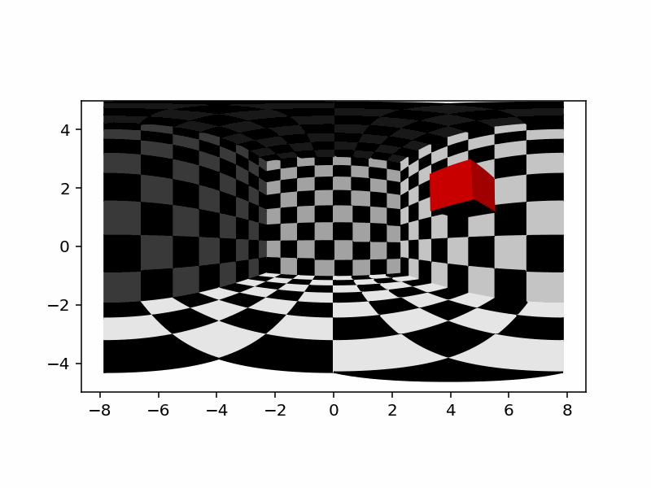

# 3D Engine From Scratch

A small software renderer written in pure Python with matplotlib as the only drawing surface. Scenes are built from triangle meshes (cubes, chessboard planes) placed in local reference frames; each frame the triangles are transformed to world space, back-face culled, sorted by distance from the camera (painter's algorithm), shaded with a directional light, and projected to 2D. Rotations use Rodrigues' formula (and a quaternion-style rotation matrix in `projections.py`). Several projectors are implemented: perspective/orthographic, spherical, stereographic and cylindrical, so the same scene can be rendered as a wide-angle panorama.

## How to run
Python 3 with `matplotlib` and `numpy`. `python Prova_buona.py` renders a 10-second animation of a rotating cube inside a chessboard room with a cylindrical projector and saves it as `prova.gif`. `examples.py`, `Trying.py` and `triangolo.py` are smaller experiments with the `projections.py` API (projecting lines and triangles onto a sphere, arcs of ellipses).

## Notes
- `vec.py` is the self-contained engine (Reference_System, Triangle, Mesh, projectors, Light_Source, Scene, Camera); `faster_projections.py` is a partial numpy rewrite.
- No z-buffer: visibility relies on sorting whole triangles, so intersecting meshes can render incorrectly.
